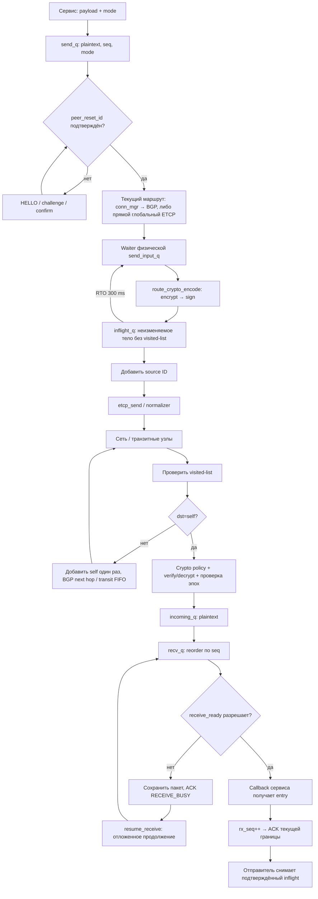
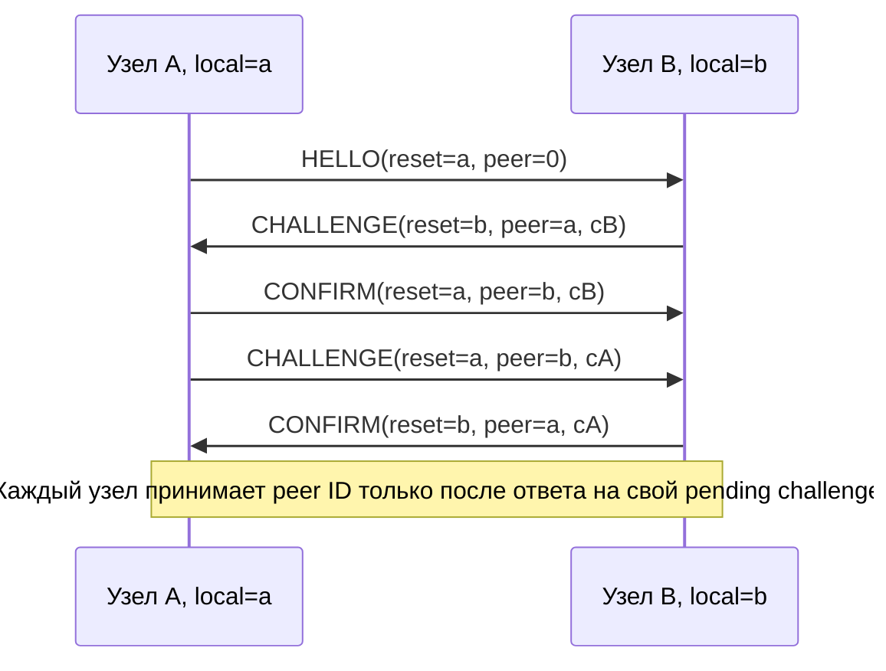

# Архитектура ETCP Router

Маршрутизатор связывает сервис с удалённым узлом через группу, не привязывая логическую
сессию к одному физическому ETCP. Ключ канала — `(group_id, remote_node_id, svc_id)`.
Wire-формат и сервисный API подробно описаны в [etcp_router_doc.md](../src/routing_layer/etcp_router_doc.md),
объявления — в [etcp_router.h](../src/routing_layer/etcp_router.h).

## Отправка и приём

Каждая кодограмма имеет самостоятельный seq; это не байтовый поток.
send_q ограничена 64 пакетами при обычной отправке, `force` обходит этот порог.
Inflight по умолчанию — 256, при minRTT probe — 4. Получатель ограничивает reorder
окном max_inflight и суммарным размером очередей max_inflight+1 записей.

Все события выполняются в uasync-потоке. Штатный normalizer откладывает physical waiters,
а callbacks производителей send_q могут выполняться синхронно при освобождении места.
Поэтому код отправки повторно проверяет состояние/эпохи после callback.

## Эпохи логического канала

Полный сетевой пакет:

`[57-byte SVC_ROUTE_HDR][payload][signature?][visited_ids:8*N][count:1]`

Числа в заголовке — native endian. flags — отдельный байт; биты seq не заняты флагами.
Заголовок включает group/src/dst/service, seq/timestamp и поля reset_id/peer_reset_id/challenge.
visited-list содержит 1..64 ID, находится вне подписи/шифрования и проверяется на каждом переходе.

Первичное согласование двух сторон имеет вид:

Получение HELLO/CHALLENGE с неизвестной эпохой само по себе не сбрасывает работающий канал.
Переставленные/старые CONFIRM не совпадают с pending ID/challenge и игнорируются.
Для одного pending peer ID повторяется тот же challenge не чаще300мс; срок nonce —2с
от первой отправки, повторы его не продлевают. Для другого peer ID создаётся новый nonce
с тем же ограничением частоты300мс: перезапуск пира во время handshake не ждёт истечения старого nonce.
После истечения срока следующий запрос получает новый nonce; старый CONFIRM отклоняется
также по возрасту. Первичный HELLO повторяется каждые300мс. Интервал повтора не меняет nonce:
ответ800мс должен подтверждать сессию и при нескольких повторных START/RST.
DEBUG etcp_route показывает candidate/nonce, repeat, возраст и received/expected для отвергнутого CONFIRM.

| Событие | Что сохраняется | Что меняется |
| --- | --- | --- |
| Смена ETCP/next hop | Логические эпохи, seq, очереди | Физический waiter/маршрут |
| Первое подтверждение peer | Накопленная send_q | Заполняется peer_reset_id, начинается отправка |
| Подтверждённый рестарт peer | Собственный reset_id | Очереди, seq, RTT/метрики; уведомление сервиса |
| Явный conn_restart | Ключ group/peer/service и адрес rconn | Новый reset_id, пустое состояние; затем callback и HELLO |
| conn_close | Только данные, переданные во владение callback | Запись снимается с реестра, ресурсы освобождаются |

Сервис возобновляет прикладную синхронизацию после сброса; старые гарантии доставки через reset не продолжаются.
Готовность router означает наличие подтверждённого peer ID. Это отдельное состояние
от физического UP и READY BGP-группы.

## Подтверждение и пауза потребителя

DATA проходят crypto policy и verify/decrypt до изменения reorder/rx_seq.
Если сервис требует SIGNED, подпись обязательна также для HELLO/CHALLENGE/CONFIRM, ACK/BUSY и CLOSE.
Пустые управляющие пакеты подписываются без шифрования; ENCRYPTED применяется к сервисному payload.
Сервис получает `[svc:1][src:8][dst:8][rx_flags:1][group:8][payload]`, всего 26 байт заголовка.
Его callback владеет entry, ACK продвигается после успешной передачи callback.

Сервис может установить `authorize(inst, group, peer)` после включения обязательного SIGNED.
Только результат 1 разрешает доступ. На входе peer — проверенный подписью конечный отправитель;
сосед ETCP может быть посредником. Предикат читает состояние допуска, не вызывает callbacks и не меняет router.
Он проверяется перед открытием канала, приёмом, каждой доставкой из reorder, отправкой и ретрансмитом.
Транзитный узел пересылает пакет без применения политики конечного сервиса.

После commit изменения членства `etcp_router_revalidate_group` закрывает запрещённые каналы,
очищает их очереди и уведомляет сервис. Общий ETCP и разрешённые каналы соседних групп сохраняются.
Байты, уже переданные нижнему транспорту, отозвать нельзя; дальнейшая отправка через router запрещена.

ACK подтверждает только диапазон до tx_sent, в модульном порядке uint32.
При продвижении снимаются существующие inflight-записи и один раз учитываются исходные payload bytes.

RECEIVE_BUSY не подтверждает отложенные DATA, но поддерживает живость ожидающего диска/буфера сервиса.
Даже при прежнем seq допустимый BUSY обновляет отсчёт RTO и останавливает новую отправку/проход ретрансмитов.
Обычный повторный ACK без продвижения этого не делает. Снятие BUSY возобновляет send_q.

receive_ready — предикат без I/O и изменения/закрытия роутера. При 0 пакет сохраняется в recv_q;
resume_receive планирует продолжение. Управляющий CLOSE не проходит через этот предикат.

| Механизм | Интервал/условие |
| --- | --- |
| ACK | Не чаще 10 ms; текущая граница повторяется при дубликате DATA после потери ACK |
| RECEIVE_BUSY | Около 100 ms, пока сервис остановлен |
| Idle ACK | 500 ms, только если rx_seq ещё не был отправлен в ACK |
| Handshake/RTO | 300 ms |
| Нет маршрута после handshake | Повторный поиск через 20 ms |
| Транзит при backpressure | Waiter + повтор выбора маршрута через 20 ms |
| Watchdog send_q | 500 ms, пока очередь непуста |
| Нет прогресса/BUSY | Закрытие после 17 циклов, для сервиса CALL — после 67 |

Транзитные очереди принадлежат физическому ETCP, сгруппированы по group/src/dst и не имеют своих seq.
При смене маршрута пакет переносится на актуальный next hop без ожидания освобождения старой очереди.
Отсутствие пути приводит к потере транзитной копии; её восстанавливает end-to-end inflight источника.

## Владение и локальная доставка

| Объект | Владение |
| --- | --- |
| Входной entry etcp_route_send | Всегда поглощается, включая ошибку |
| Буфер etcp_router_conn_send | Заимствован на время копирования |
| ETCP_ROUTER_CONN из conn_get | Заимствован до close/destroy |
| Сервисный entry | Передаётся callback; освободить dgram и entry |
| Физический conn в callback | Заимствован, может обозначать транзитного пира |
| Синтетический conn | Только на время callback, instance/peer=self; без сетевого send/ref_take |
| Send-ready handle/arg | У производителя до callback/отмены; перед освобождением отменить |

Self-доставка через etcp_route_send синхронна и не создаёт канал. Она обходит сетевые crypto policy
и receive_ready, выдаёт rx_flags=0; режим проверяется на допустимые биты.
Предикат authorize применяется и к self-доставке.
Payload должен быть непустым и помещаться вместе с 26-байтным заголовком в uint16 длину.
Нет обработчика, переполнение размера или отказ памяти возвращают -1.
Отдельный синтетический conn каждого вызова сохраняет контекст при вложенных доставках разных ядер.

Закрываемый канал удаляется из реестра до callback. Callback может закрывать группу/другие каналы
или открыть замену с тем же ключом; старая запись не возвращается повторным поиском.
Память канала и send_q освобождается отложенно за пределами текущего callback.
До массовой остановки сервисы отменяют producers/waiters; уничтожение ядра из callback останавливаемого сервиса запрещено.

close_group удаляет логические каналы и pending transit указанной группы.
destroy снимает wire callback, закрывает все логические каналы и очищает транзитные очереди,
таймеры и waiters на всех живых ETCP. Уничтожать сам ETCP для очистки роутера не требуется.

Метрики delivery считают первые подтверждения исходного payload, без заголовков/crypto/ретрансмитов.
RTT — 0.1 ms, snapshot API выдаёт микросекунды; jitter — unsigned 16.16 EWMA,
монитор публикует удвоенный EWMA. Очереди, метрики и параметры minRTT сбрасываются вместе с логической сессией.
